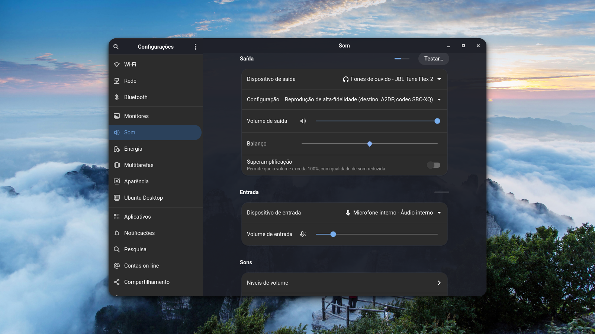
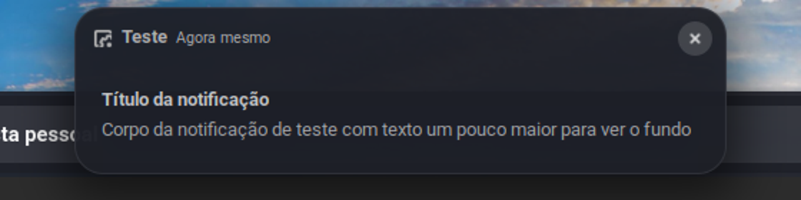

<div align="center">

# ChromeOS-Fluent

**Tema para GNOME (Shell, GTK 3, GTK 4 e libadwaita) com a geometria do ChromeOS e o acabamento do Windows 11.**
Cantos grandes, pílulas, translucidez e sombras suaves, **sem blur real**, leve até em PC antigo.
Segue a **cor de destaque do sistema** e muda tudo junto: Shell, apps, ícones de pasta e ArcMenu.




</div>

## Destaques

- **Translucidez sem blur.** Superfícies `rgba(30, 32, 40, 0.88)` (modais 0.94). Nada de Blur My Shell, então o custo de CPU/GPU é praticamente zero.
- **Segue o destaque do sistema.** Mude em *Configurações → Aparência* e o tema inteiro acompanha em milissegundos, incluindo ícones de pasta e SVGs de toggle e checkbox.
- **Uma linguagem só.** Mesmos tokens do [Gavetta](https://github.com/bcocheto/gavetta), do [Cadência](https://github.com/bcocheto/cadencia) e do [Clima](https://github.com/bcocheto/clima).
- **Cobertura ampla.** GNOME Shell 50, GTK 3, GTK 4/libadwaita (Arquivos, Configurações, Terminal etc.) e molduras de janelas X11.
- **Contraste verificado** nos 10 destaques (azul, verde-água, verde, amarelo, laranja, vermelho, rosa, roxo, ardósia e marrom).
- **Leve de propósito.** Uma única camada de sombra, transições curtas, ripple desligado no GTK 4.

## Notificações no mesmo padrão



## Tokens de design

| Token | Valor |
|---|---|
| Superfície | `rgba(30, 32, 40, 0.88)`, modal `0.94` |
| Borda | `1px rgba(255, 255, 255, 0.09)` |
| Raios | 12 · 18 · 20 · 28 · pílula (`9999px`) |
| Hover / ativo | branco a `0.10` / `0.16` |
| Anel de foco | 2px na cor de destaque clara |
| Sombra do Shell | `0 8px 28px rgba(0,0,0,0.55)` (camada única: o St ignora as demais) |
| Altura do cabeçalho | 40px (base do libadwaita) |

## Requisitos

- **GNOME Shell 50** (Ubuntu 26.04). Outras versões podem funcionar, mas só esta foi testada.
- **GTK 4/libadwaita** (já vem no GNOME).
- `python3`, `gsettings`, `dconf` e `systemd --user` (padrão no Ubuntu).

### Extensões do GNOME Shell

| Extensão | Papel | Obrigatória? |
|---|---|---|
| [User Themes](https://extensions.gnome.org/extension/19/user-themes/) (`user-theme@gnome-shell-extensions.gcampax.github.com`) | Carrega o tema do **Shell** a partir de `~/.themes` | **Sim**, sem ela só os apps são tematizados |
| [Dash to Panel](https://extensions.gnome.org/extension/1160/dash-to-panel/) | Barra única estilo Windows/ChromeOS | Recomendada |
| [ArcMenu](https://extensions.gnome.org/extension/3628/arcmenu/) | Menu de aplicativos; o `fluent-accent-sync` ajusta as cores dele | Recomendada |
| [Gavetta](https://github.com/bcocheto/gavetta) | Histórico da área de transferência | Opcional |
| [Cadência](https://github.com/bcocheto/cadencia) | Controle de mídia (MPRIS) | Opcional |
| Tiling Assistant, Ubuntu AppIndicators | Já vêm no Ubuntu | Opcional |

Os ajustes de Dash to Panel e ArcMenu usados nas capturas estão em [`config/extensions.dconf`](config/extensions.dconf).

### Ícones (opcional, recomendado)

O tema de ícones **Tela-circle** ([vinceliuice/Tela-circle-icon-theme](https://github.com/vinceliuice/Tela-circle-icon-theme)) é usado como base. O script gera `Tela-circle-accent`, uma cópia em que as **pastas seguem a cor de destaque**. Sem o Tela-circle o tema funciona normalmente e só os ícones ficam como estão.

## Instalação

```bash
git clone https://github.com/bcocheto/chromeos-fluent.git
cd chromeos-fluent
./install.sh              # tema + serviço de destaque
./install.sh --extensions # idem, e aplica os ajustes do Dash to Panel/ArcMenu
```

Depois feche os apps (`nautilus -q`) ou faça logout/login. O instalador:

1. copia o tema para `~/.themes/ChromeOS-Fluent`;
2. instala `fluent-accent-sync` e `fluent-shot` em `~/.local/bin`;
3. liga `~/.config/gtk-4.0/gtk.css` ao tema, com backup do arquivo existente (é assim que o libadwaita o lê);
4. ativa o serviço `fluent-accent.service`;
5. aplica tema GTK, tema do Shell, tema de janelas e ícones via `gsettings`/`dconf`.

Para remover: `./uninstall.sh`.

## Como funciona a cor de destaque

Os arquivos `*.css` do tema são **gerados**. A fonte são os `*.tpl`, com os marcadores `@ACC@`, `@ACCL@`, `@ACCFG@`, `@ACC_RGB@` e `@ACCL_RGB@`:

```
gsettings accent-color ──▶ fluent-accent-sync ──▶ gtk-3.0/*.css · gtk-4.0/*.css
        ▲                       │                  gnome-shell.css · SVGs (toggle, checkbox)
        │                       ├──▶ Tela-circle-accent (pastas)
fluent-accent.service ◀─────────┴──▶ ArcMenu (dconf)
```

O serviço `systemd --user` observa `org.gnome.desktop.interface accent-color` e roda o `fluent-accent-sync` a cada troca.

> **Edite apenas os `.tpl`.** O `fluent-accent-sync` regenera os `.css` e apaga qualquer alteração feita neles à mão. As regras do tema ficam antes do marcador `/* ===== /Fluent layer ===== */` de cada `.tpl`.

## Estrutura

```
theme/ChromeOS-Fluent/   tema (gnome-shell, gtk-2.0/3.0/4.0, assets) + .tpl
bin/fluent-accent-sync   renderiza o tema com o destaque atual
bin/fluent-shot          captura apps num GNOME Shell headless (teste visual)
tools/harness.py         harness do fluent-shot (Mutter ScreenCast + GStreamer)
systemd/                 fluent-accent.service
config/extensions.dconf  ajustes de Dash to Panel e ArcMenu
```

## Testar sem tocar na sua sessão

`fluent-shot` sobe um `gnome-shell --headless` em um bus privado, abre os apps e grava `shot.png`:

```bash
fluent-shot /tmp/saida "nautilus --new-window,gnome-control-center appearance"
```

Requer `gnome-shell` com suporte a `--headless`, PipeWire e GStreamer.

## Limitações conhecidas

- **Flatpak e Snap** não enxergam `~/.themes`. Para um app Flatpak: `flatpak override --user --filesystem=~/.themes:ro <app>`.
- **Electron** (Spotify, VS Code etc.) ignora o GTK; só as molduras de janela X11 são tematizadas.
- **Sem blur real**, por escolha. A translucidez é só de cor.
- O St do GNOME Shell usa só a primeira camada de `box-shadow`.
- O alinhamento do cabeçalho do Arquivos é ajustado visualmente (margens e faixa de fundo), não é pixel-perfect.

## Créditos e licença

Parte da base GTK/Shell vem do tema **ChromeOS** (derivado do Materia/Elegant Design), sob GPL-3.0, e esta variação mantém a mesma licença. Veja [`LICENSE`](LICENSE). Ícones: Tela-circle (vinceliuice).
